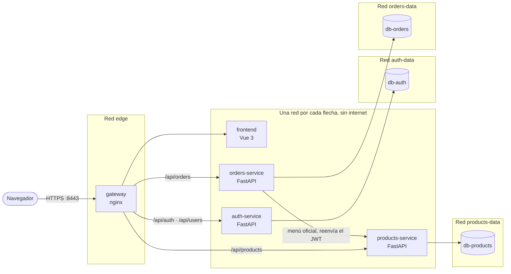

# Documentación del sistema

**PerroCaliente Express** es un sistema de ventas de perros calientes hecho para
la clase de **Seguridad de la Información**. El negocio es pequeño a propósito
(menú, caja, usuarios y bitácora) para que se vea con claridad cómo se reparte
un sistema en microservicios y qué control protege cada frontera.

Esta página describe el sistema tal como está construido. Los controles de
seguridad, el modelo de amenazas, el guion de la demo y la revisión
independiente están en documentos aparte:

- [Controles de seguridad](SEGURIDAD.md)
- [Modelo de amenazas](MODELO-DE-AMENAZAS.md)
- [Guion de la demo](DEMO.md)
- [Revisión independiente](REVISION.md)

## Qué hace

Un cajero arma un pedido y registra la venta. Un administrador, además, mantiene
el menú, crea usuarios y consulta la auditoría de los tres servicios. El
navegador nunca envía precios: el servidor los consulta al menú oficial y
calcula el total.

Hay dos roles:

| Rol | Puede |
|---|---|
| `cashier` | Iniciar sesión, vender, ver sus propias ventas y el resumen de las últimas 24 horas. |
| `admin` | Todo lo anterior, más el menú completo, todos los usuarios, todas las ventas y las tres bitácoras. |

La guarda de rutas del frontend solo oculta pantallas. Cada permiso se decide
otra vez en el servidor, en cada petición.

## Stack

| Pieza | Tecnología |
|---|---|
| Interfaz | Vue 3, Vite, Pinia, Vue Router |
| Servicios | Python 3.12, FastAPI, SQLAlchemy, Pydantic |
| Contraseñas | Argon2id (`argon2-cffi`) |
| Tokens | JWT RS256 (`PyJWT`) |
| Datos | PostgreSQL 17, una base por servicio |
| Puerta de entrada | nginx sin privilegios, TLS 1.2 y 1.3 |
| Orquestación | Docker Compose: 8 contenedores, 9 redes |

## Repositorios

Todos se clonan en la misma carpeta. `hotdog-infra` los referencia como
hermanos (`../hotdog-frontend`, etc.).

| Repositorio | Responsabilidad |
|---|---|
| [hotdog-frontend](https://github.com/SeguridadInfromacion/hotdog-frontend) | Interfaz. No guarda el token. |
| [hotdog-auth-service](https://github.com/SeguridadInfromacion/hotdog-auth-service) | Login, usuarios y firma de tokens. Único dueño de la llave privada. |
| [hotdog-products-service](https://github.com/SeguridadInfromacion/hotdog-products-service) | CRUD del menú. Solo verifica tokens. |
| [hotdog-orders-service](https://github.com/SeguridadInfromacion/hotdog-orders-service) | Registro e historial de ventas. Pregunta precios a productos. |
| [hotdog-database](https://github.com/SeguridadInfromacion/hotdog-database) | Esquemas SQL, menú inicial y permisos de mínimo privilegio. |
| [hotdog-infra](https://github.com/SeguridadInfromacion/hotdog-infra) | Compose, gateway, generación de secretos y pruebas en vivo. |
| hotdog-docs | Esta documentación. |

Cada servicio Python sigue la misma forma: `routes` traduce HTTP, `services`
aplica las reglas, `repositories` habla con la base, `schemas` valida la
entrada y `security` / `dependencies` comprueban el token y el rol.

## Arquitectura



El navegador solo habla con el gateway. El gateway reparte por prefijo de ruta.
Los servicios no se llaman entre sí salvo `orders-service` → `products-service`.
Ningún servicio alcanza la base de otro.

### Contenedores

| Contenedor | Escucha | Con quién habla |
|---|---|---|
| `gateway` | 8443 (HTTPS) y 8080 (HTTP, redirige) | frontend, auth, products, orders |
| `frontend` | 8080 interno | solo el gateway |
| `auth-service` | 8000 interno | gateway y `db-auth` |
| `products-service` | 8000 interno | gateway, `orders-service` y `db-products` |
| `orders-service` | 8000 interno | gateway, `products-service` y `db-orders` |
| `db-auth`, `db-products`, `db-orders` | 5432 interno | solo su servicio |

El único puerto publicado en la máquina anfitriona es el del gateway, y por
defecto solo en `127.0.0.1`.

### Redes

Cada flecha del diagrama es una red Docker propia. Todas son internas (sin
salida a internet) menos `edge`, que es la del gateway.

| Red | Quién está |
|---|---|
| `edge` | gateway (salida hacia el navegador) |
| `gw-frontend` | gateway, frontend |
| `gw-auth` | gateway, auth-service (`172.30.1.0/29`) |
| `gw-products` | gateway, products-service (`172.30.2.0/29`) |
| `gw-orders` | gateway, orders-service (`172.30.3.0/29`) |
| `orders-products` | orders-service, products-service |
| `auth-data` | auth-service, db-auth |
| `products-data` | products-service, db-products |
| `orders-data` | orders-service, db-orders |

Las tres subredes del gateway están fijas para que cada servicio solo acepte
`X-Forwarded-For` si viene de esa subred (`FORWARDED_ALLOW_IPS`).

## Pantallas

| Ruta | Quién la ve | Qué hace |
|---|---|---|
| `/entrar` | cualquiera | Inicia sesión |
| `/vender` | cajero y admin | Arma el pedido y registra la venta |
| `/ventas` | cajero y admin | Historial y resumen de las últimas 24 horas |
| `/menu` | admin | Alta, cambio y baja de productos |
| `/usuarios` | admin | Alta, edición, activación y desactivación |
| `/auditoria` | admin | Junta las tres bitácoras. Si un servicio no responde, muestra las otras y avisa cuál falta |

## Modelo de datos

Hay tres bases PostgreSQL. No hay llaves foráneas entre ellas: una venta guarda
copia del nombre y del precio del momento, y el id del cajero se copia del token.
Los precios son enteros en pesos colombianos, sin decimales.

### Base `auth`

`users`

| Columna | Tipo | Regla |
|---|---|---|
| `id` | uuid | clave primaria |
| `username` | varchar(32) | único, `^[a-z0-9_.-]{3,32}$` |
| `full_name` | varchar(80) | al menos 2 caracteres |
| `password_hash` | varchar(255) | hash Argon2id, nunca la contraseña |
| `role` | varchar(16) | `admin` o `cashier` |
| `is_active` | boolean | un usuario se desactiva, no se borra |
| `token_version` | integer ≥ 0 | sube al salir, cambiar contraseña o cambiar rol |
| `created_at` | timestamptz | |

`login_throttle`: intentos fallidos por pareja `(username, ip)`. Tras 5 fallos,
esa pareja queda bloqueada 15 minutos. Borrar un usuario (cosa que la aplicación
no puede hacer) borra sus filas de bloqueo.

### Base `products`

`products`

| Columna | Tipo | Regla |
|---|---|---|
| `id` | uuid | clave primaria |
| `name` | varchar(60) | único, también sin distinguir mayúsculas |
| `description` | varchar(200) | |
| `price` | integer | entre 100 y 1 000 000 |
| `is_available` | boolean | |
| `created_at`, `updated_at` | timestamptz | |

El menú inicial trae seis productos (de 8 000 a 18 000 pesos).

### Base `orders`

`orders`: `id`, `cashier_id`, `cashier_username`, `customer_name`, `total` (> 0),
`created_at`.

`order_items`: `order_id`, `product_id`, `product_name`, `unit_price` (> 0),
`quantity` (1 a 20) y `line_total`, con la restricción
`line_total = unit_price * quantity`.

### Bitácora (las tres bases)

`audit_log`: `occurred_at`, `actor`, `action`, `target`, `ip`. El rol de la
aplicación solo puede insertar y leer. Cada consulta de auditoría devuelve las
100 entradas más recientes.

| Servicio | Acciones |
|---|---|
| auth | `login.ok`, `login.fallido`, `login.bloqueo`, `logout`, `usuario.crear`, `usuario.editar` |
| products | `producto.crear`, `producto.editar`, `producto.eliminar` |
| orders | `venta.registrar` |

### Permisos del rol de aplicación

Cada rol nace sin permisos sobre las tablas y con tope de 20 conexiones y 5
segundos por consulta. Después recibe solo esto:

| Rol | Tablas |
|---|---|
| `auth_app` | `SELECT, INSERT, UPDATE` en `users`; CRUD en `login_throttle`; `SELECT, INSERT` en `audit_log` |
| `products_app` | CRUD en `products`; `SELECT, INSERT` en `audit_log` |
| `orders_app` | `SELECT, INSERT` en `orders` y `order_items`; `SELECT, INSERT` en `audit_log` |

## Sesión

1. `POST /api/auth/login` verifica la contraseña con Argon2id.
2. `auth-service` firma un JWT RS256 con la llave privada y lo pone en la cookie
   `access_token` (`HttpOnly`, `Secure`, `SameSite=Strict`, ruta `/api`).
3. El token dura 10 minutos. El frontend lo renueva con `POST /api/auth/refresh`
   mientras la sesión no supere las 10 horas desde el login original.
4. Cerrar sesión, cambiar la contraseña, cambiar el rol o desactivar al usuario
   sube `token_version`. `auth-service` rechaza el token viejo de inmediato.
   Los otros dos servicios no consultan la base de auth: aceptan el token hasta
   que venza (como máximo 10 minutos). Esa ventana está documentada en
   [Limitaciones conocidas](SEGURIDAD.md#limitaciones-conocidas).

El token lleva `sub` (id), `username`, `name`, `role`, `ver` (versión),
`auth_time`, `iss` (`hotdog-auth`), `aud` (`hotdog-api`), `iat`, `exp` y `jti`.
Se exige el algoritmo RS256. Un `alg: none` o un HS256 se rechaza.

También se acepta `Authorization: Bearer`. Las peticiones que no son `GET`,
`HEAD` u `OPTIONS` deben traer `X-Requested-With: XMLHttpRequest`.

Si el usuario no existe, la respuesta es la misma y tarda lo mismo que si la
contraseña fuera incorrecta. El mensaje tampoco dice si la cuenta está bloqueada.

## API

Todo pasa por el gateway en `https://localhost:8443`. El cuerpo es JSON. Los
precios y los totales son enteros. Los identificadores son UUID.

Los errores de negocio responden `{"detail": "mensaje"}`. Un error de
validación responde `422` con `{"detail": [{"loc": [...], "msg": "..."}]}` y
**no** incluye el valor enviado. Un fallo no previsto responde
`{"detail": "Ocurrió un error interno."}`.

| Código | Cuándo |
|---|---|
| 401 | Sin sesión, token inválido o credenciales incorrectas |
| 403 | El rol no alcanza, o falta la cabecera anti-CSRF |
| 404 | El recurso no existe |
| 409 | Conflicto (usuario o producto duplicado) |
| 422 | El cuerpo no cumple el contrato |
| 429 | El gateway cortó por exceso de peticiones |
| 503 | `products-service` no respondió o su respuesta no era usable |

El login admite 10 peticiones por minuto por IP (ráfaga de 5). El resto de la
API admite 20 por segundo. El cuerpo máximo es 64 KB. `/health`, `/docs` y las
rutas internas no se publican.

### Auth — `auth-service`

`POST /api/auth/login` — cualquiera.

```json
{ "username": "cajero", "password": "············" }
```

Responde `200` con la cookie y:

```json
{
  "user": {
    "id": "…uuid…",
    "username": "cajero",
    "full_name": "Cajero de turno",
    "role": "cashier",
    "is_active": true,
    "created_at": "2026-11-16T12:00:00Z"
  },
  "expires_at": "2026-11-16T12:10:00Z"
}
```

| Método | Ruta | Quién | Resultado |
|---|---|---|---|
| POST | `/api/auth/refresh` | con sesión vigente y usuario activo | Cookie nueva y el mismo cuerpo que el login |
| POST | `/api/auth/logout` | cualquiera | `204`. Si el token era válido, lo invalida |
| GET | `/api/auth/me` | con sesión | El usuario, sin `expires_at` |
| GET | `/api/auth/audit` | admin | Lista de la bitácora |

### Usuarios — `auth-service`

Solo admin.

`POST /api/users` — `201`.

```json
{
  "username": "ana",
  "full_name": "Ana Ruiz",
  "password": "caja-segura1",
  "role": "cashier"
}
```

El usuario tiene de 3 a 32 caracteres (`a-z`, dígitos, `_`, `.`, `-`). El nombre
completo, de 2 a 80. La contraseña, de 10 a 128, con al menos una letra y un
número. El rol es `admin` o `cashier`.

`PATCH /api/users/{id}` acepta cualquiera de `full_name`, `role`, `is_active` y
`password`. Un administrador no puede desactivarse ni bajarse de rol a sí mismo.

`GET /api/users` devuelve la lista. Ninguna respuesta incluye el hash.

### Menú — `products-service`

Leer: cualquier sesión. Escribir: admin.

`POST /api/products` y `PUT /api/products/{id}`:

```json
{
  "name": "Perro Picante",
  "description": "Salchicha, jalapeños y salsa.",
  "price": 11000,
  "is_available": true
}
```

`name` de 2 a 60, `description` hasta 200, `price` entero entre 100 y 1 000 000.
`description` e `is_available` tienen valor por defecto (`""` y `true`).

| Método | Ruta | Quién | Resultado |
|---|---|---|---|
| GET | `/api/products` | sesión | Lista. `?only_available=true` oculta los agotados |
| GET | `/api/products/{id}` | sesión | Un producto |
| POST | `/api/products` | admin | `201` |
| PUT | `/api/products/{id}` | admin | Reemplaza el producto |
| DELETE | `/api/products/{id}` | admin | `204` |
| GET | `/api/products/audit` | admin | Bitácora del menú |

Un producto responde `id`, `name`, `description`, `price`, `is_available` y
`updated_at`.

### Ventas — `orders-service`

`POST /api/orders` — cualquier sesión. `201`.

```json
{
  "customer_name": "Doña Marta",
  "items": [{ "product_id": "…uuid…", "quantity": 2 }]
}
```

De 1 a 20 renglones, sin repetir producto. Cada cantidad va de 1 a 20.
`customer_name` es opcional y llega hasta 60 caracteres. Un campo extra
(`unit_price`, `total`, etc.) hace que la petición se rechace.

Respuesta:

```json
{
  "id": "…uuid…",
  "cashier_username": "cajero",
  "customer_name": "Doña Marta",
  "total": 24000,
  "created_at": "2026-11-16T12:05:00Z",
  "items": [
    {
      "product_name": "Perro Especial",
      "unit_price": 12000,
      "quantity": 2,
      "line_total": 24000
    }
  ]
}
```

| Método | Ruta | Quién | Resultado |
|---|---|---|---|
| GET | `/api/orders` | sesión | Hasta 100 ventas. Un cajero ve solo las suyas |
| GET | `/api/orders/summary` | sesión | `{ "orders_count", "revenue" }` de las últimas 24 horas, con el mismo filtro |
| GET | `/api/orders/audit` | admin | Bitácora de ventas |

Si un producto no existe o está agotado, la venta no se guarda. Si
`products-service` no responde a tiempo (3 segundos) o su menú no cumple los
límites, la venta falla con 503.

## Cómo se registra una venta

1. El cajero inicia sesión. Recibe la cookie.
2. Elige productos. El frontend envía solo ids y cantidades.
3. El gateway aplica el límite de peticiones y reenvía a `orders-service`,
   poniendo la IP real en `X-Forwarded-For`.
4. `orders-service` verifica el JWT (firma, vencimiento, emisor y audiencia) y
   pide el menú a `products-service` en una sola llamada, reenviando el token.
5. `products-service` verifica el token otra vez y responde.
6. `orders-service` valida esa respuesta (precio positivo y acotado, nombre con
   longitud máxima), calcula el total, guarda la venta con la copia del nombre
   y del precio, y escribe `venta.registrar` en su bitácora.

## Cómo levantarlo

Hace falta Docker. Los siete repositorios deben estar en la misma carpeta.

```bash
cd hotdog-infra
docker compose -f docker-compose.setup.yml run --rm setup
docker compose up -d --build
```

El primer comando crea `secrets/` (llaves JWT y certificado TLS) y `.env`
(contraseñas de las bases y de `admin` y `cajero`). Ninguno se sube a git.
Luego se abre <https://localhost:8443> y se acepta el certificado autofirmado.
Los usuarios y las contraseñas están en `.env`.

Si 8443 u 8080 están ocupados, se cambian `HTTPS_PORT` o `HTTP_PORT` en `.env`.
Para abrirlo desde otra máquina hay que agregar el nombre o la IP a
`SERVER_NAME`, poner `BIND_ADDRESS=0.0.0.0` y generar un certificado para ese
nombre. Una cabecera `Host` que no esté en `SERVER_NAME` corta la conexión.

```bash
docker compose ps
docker compose logs -f auth-service
docker compose down          # apaga y conserva los datos
docker compose down -v       # apaga y borra las bases
```

Los scripts SQL de `hotdog-database` corren solo la primera vez que se crea el
volumen. Un cambio de esquema en desarrollo se aplica con `down -v` y volver a
levantar.

### Desarrollo de un solo servicio

Los tres servicios se prueban sin Docker: pytest usa SQLite en memoria.

```bash
python -m venv .venv
.venv\Scripts\activate          # Windows
pip install -r requirements-dev.txt
pytest
ruff check .
bandit -r app
```

El frontend, con el sistema ya levantado:

```bash
npm ci
npm run dev     # http://localhost:5173, contra el gateway local
npm test
npm run lint
```

`ENABLE_DOCS=true` publica `/docs` de FastAPI. En el compose queda apagado.

### Comprobar el sistema en ejecución

Desde `hotdog-infra`:

```bash
bash scripts/security-checks.sh
```

Son 61 verificaciones contra el sistema levantado: tokens falsos, inyección,
escalamiento de rol, fuerza bruta, aislamiento de red y permisos de la base.

## Secretos y variables

El setup genera valores al azar. `.env.example` muestra los nombres, no los
valores reales.

| Variable | Quién la usa |
|---|---|
| `BIND_ADDRESS`, `HTTPS_PORT`, `HTTP_PORT`, `SERVER_NAME` | gateway |
| `AUTH_DB_ROOT_PASSWORD`, `AUTH_DB_PASSWORD` | `db-auth` y la URL de `auth-service` |
| `PRODUCTS_DB_*`, `ORDERS_DB_*` | igual, cada uno en su base |
| `ADMIN_USERNAME`, `ADMIN_PASSWORD` | primer arranque de auth, si la base está vacía. Sin ellos el servicio no arranca |
| `DEMO_CASHIER_USERNAME`, `DEMO_CASHIER_PASSWORD` | cajero inicial, opcional |
| `DATABASE_URL` | cada servicio |
| `JWT_PRIVATE_KEY_FILE` | solo auth |
| `JWT_PUBLIC_KEY_FILE` | los tres servicios |
| `PRODUCTS_SERVICE_URL` | orders (`http://products-service:8000`) |
| `FORWARDED_ALLOW_IPS` | subred del gateway que puede informar la IP del cliente |
| `ACCESS_TOKEN_MINUTES` (10), `SESSION_HOURS` (10) | duración del token y tope de la sesión |
| `PRODUCTS_TIMEOUT_SECONDS` (3) | espera máxima al menú |
| `ENABLE_DOCS` (false) | OpenAPI |

## Integración continua

Cada servicio de aplicación tiene un flujo en GitHub Actions que corre el
linter, las pruebas y el análisis de dependencias (`bandit` y `pip-audit`, o
`npm audit` en el frontend). Las versiones de las librerías están fijadas.
