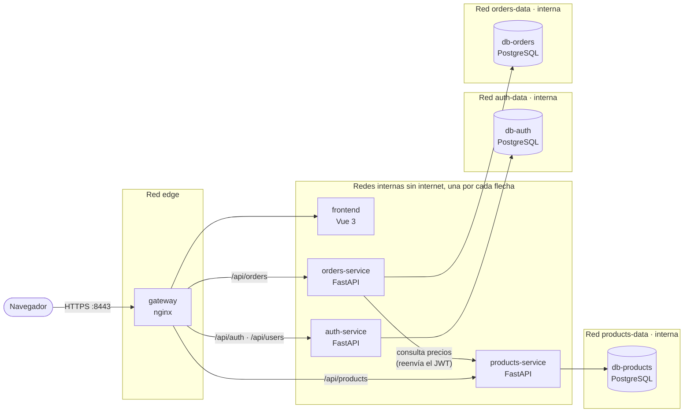

# PerroCaliente Express 🌭

Sistema distribuido de ventas de perros calientes, construido para la clase de
**Seguridad de la Información**. Es pequeño a propósito (un CRUD de productos y
un registro de ventas) para que lo importante se vea claro: **cómo se construye
software en el que se puede confiar**.

## Arquitectura

Son **8 contenedores** en **9 redes**: cada flecha del diagrama es una red
interna propia, así que dos contenedores solo se ven si de verdad necesitan
hablarse. El único puerto publicado es el del gateway. Cada servicio tiene su
propia base de datos y ninguno puede alcanzar la base de otro.

## Repositorios

| Repositorio | Qué contiene |
|---|---|
| [hotdog-frontend](https://github.com/SeguridadInfromacion/hotdog-frontend) | Interfaz en Vue 3 |
| [hotdog-auth-service](https://github.com/SeguridadInfromacion/hotdog-auth-service) | Inicio de sesión, usuarios y emisión de tokens |
| [hotdog-products-service](https://github.com/SeguridadInfromacion/hotdog-products-service) | CRUD del menú |
| [hotdog-orders-service](https://github.com/SeguridadInfromacion/hotdog-orders-service) | Registro de ventas |
| [hotdog-database](https://github.com/SeguridadInfromacion/hotdog-database) | Esquemas SQL, datos iniciales y roles de mínimo privilegio |
| [hotdog-infra](https://github.com/SeguridadInfromacion/hotdog-infra) | Docker Compose, gateway nginx, generación de secretos y pruebas de seguridad |
| hotdog-docs | Esta documentación |

## Ponerlo a andar

Solo se necesita Docker. Las instrucciones están en
[hotdog-infra](https://github.com/SeguridadInfromacion/hotdog-infra#ponerlo-a-andar).

## Documentos

- [Documentación del sistema](DOCUMENTACION.md): arquitectura, datos, API, sesión y cómo levantarlo.
- [Controles de seguridad](SEGURIDAD.md): qué protege al sistema y en qué archivo está cada control.
- [Modelo de amenazas](MODELO-DE-AMENAZAS.md): qué puede salir mal y cómo se mitiga (STRIDE).
- [Guion de la demo](DEMO.md): paso a paso para mostrarlo en clase.
- [Revisión independiente](REVISION.md): qué encontraron los revisores y cómo se corrigió.

## Cómo viaja una venta

1. El cajero inicia sesión. `auth-service` verifica la contraseña (Argon2id) y
   firma un JWT con su **llave privada**. El token llega al navegador en una
   cookie `HttpOnly`, dura 10 minutos y el navegador lo renueva solo.
2. El cajero arma el pedido y lo envía: solo **ids y cantidades**, nunca precios.
3. El gateway aplica límite de peticiones y reenvía a `orders-service`.
4. `orders-service` verifica el token con la **llave pública** y le pide a
   `products-service` el menú oficial (una sola llamada), reenviando el token.
5. `products-service` verifica el token **otra vez** y responde. `orders-service`
   valida esa respuesta antes de usarla.
6. `orders-service` calcula el total, guarda la venta y deja el registro en su
   bitácora de auditoría.
